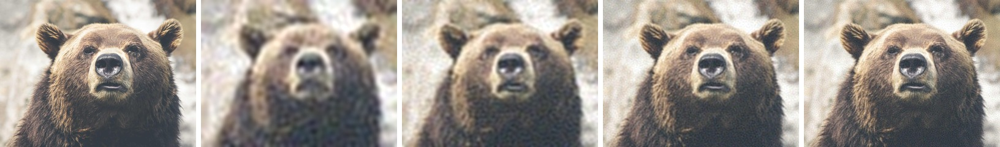

<p align="center"><a href="README.md">한국어</a> · <a href="README.en.md">English</a> · <a href="README.ja.md">日本語</a> · <a href="README.es.md">Español</a></p>

# 400자 짤 압축기

사진을 댓글 한 줄에 들어가는 글자로 바꾸고, 그 글자를 다시 사진으로 보여 주는 웹 페이지.

**https://g.yeon.at/**



<sub>왼쪽부터 원본, 400자, 1,000자, 4,000자, 7,000자(한글 코드, 주소 포함). 사진: Thomas Lefebvre / Unsplash</sub>

디시인사이드 댓글처럼 글자 수가 짧고 그림을 올릴 수 없는 곳에서 사진을 주고받기 위해 만들었다. 사진은 브라우저 안에서 수백 바이트로 압축되어 `https://g.yeon.at/?뗈앏괟…` 같은 한 줄이 되고, 받는 사람은 그 링크를 열어 사진을 본다.

- 서버도, 업로드도, 저장소도 없다. 코드 자체가 사진이다.
- 한글 음절 한 글자에 13비트를 담아, 같은 글자 수에 영문보다 약 2.2배 많은 정보를 싣는다.
- 글자 수 제한을 늘리면 사진을 담는 격자가 64픽셀에서 512픽셀까지 커지며 선명해진다.
- HTML 파일 하나로 동작한다.

## 목차

1. [사용법](#사용법)
2. [코드와 링크](#코드와-링크)
3. [화질](#화질)
4. [개인정보와 동작 환경](#개인정보와-동작-환경)
5. [한계](#한계)
6. [문제 해결](#문제-해결)
7. [자주 묻는 질문](#자주-묻는-질문)
8. [구현 논고](#구현-논고)
   - [설계 목표](#설계-목표)
   - [전처리](#전처리)
   - [변환](#변환)
   - [양자화](#양자화)
   - [엔트로피 부호화](#엔트로피-부호화)
   - [비트스트림](#비트스트림)
   - [글자 변환](#글자-변환)
   - [율 제어와 격자 선택](#율-제어와-격자-선택)
   - [복원과 확대](#복원과-확대)
   - [주소와 전송](#주소와-전송)
   - [페이지 설계](#페이지-설계)
   - [화질 평가](#화질-평가)
   - [PSNR의 수학](#psnr의-수학)
9. [참고 문헌](#참고-문헌)

## 사용법

페이지는 **만들기**, **보기**, **JPG data 링크** 세 탭으로 이루어진다.

### 만들기

1. 사진을 끌어다 놓거나, 상자를 눌러 고르거나, Ctrl/⌘+V로 붙여넣는다. 여러 장을 한 번에 넣을 수 있다.
2. 사진마다 카드가 생긴다. 왼쪽은 원본, 오른쪽은 받는 사람이 보게 될 사진이다.
3. **복사**를 누르면 주소와 코드가 한 줄로 복사된다. 그 줄을 댓글에 그대로 붙인다.

카드 아래에는 원본 크기, 코드 글자 수, 전체 글자 수와 제한, 격자 크기, 압축 단계(0~127, 낮을수록 고움)가 표시된다.

| 설정 | 기본값 | 설명 |
|---|---|---|
| 코드 글자 | 한글 | 한글은 한 글자에 13비트, 영문은 6비트를 담는다. 영문은 한글을 쓸 수 없는 곳을 위한 것이다. |
| 글자 수 제한 | 400 | 디시 댓글(400), 트윗(280), 1,000 단추가 있고 직접 입력할 수도 있다. |
| 앞에 붙일 주소 | `https://g.yeon.at/?` | 코드 앞에 붙는 글자. 비우면 코드만 만든다. |

설정을 바꾸면 넣어 둔 사진이 모두 다시 압축되고, 설정은 브라우저에 기억된다.

### 보기

받은 링크를 열면 이 탭이 바로 열리고 사진이 나타난다. 코드를 복사해 이 탭에 붙여넣어도 된다. 앞뒤에 다른 글이 섞여 있어도 코드 부분만 찾아 읽는다.

### JPG data 링크

`data:` 링크를 그림으로 보여 주는 곳(HTML이나 마크다운 이미지를 허용하는 곳)을 위한 도구다. 사진을 JPG로 다시 압축해 `data:image/jpeg;base64,…` 링크를 만든다. 목표 길이에 맞춰 품질을 찾거나 품질을 직접 정할 수 있고, 링크, `` 태그, 마크다운으로 복사한다. 같은 글자 수라면 **만들기** 탭의 코드가 더 선명하다([화질](#화질) 참고).

## 코드와 링크

| 형식 | 예 | 코드에 쓰는 글자 | 담기는 양 |
|---|---|---|---|
| 한글 + 주소(기본) | `https://g.yeon.at/?뗈앏괟…` | 381자 | 약 619바이트 |
| 영문 + 주소 | `https://g.yeon.at/?TqVTweO…` | 381자 | 약 285바이트 |
| 한글 코드만 | `뗈앏괟…` | 400자 | 650바이트 |
| 영문 코드만 | `TqVTweO…` | 400자 | 300바이트 |

- 주소가 `https://`로 시작해야 댓글에서 눌리는 링크가 된다.
- 코드가 길어 주소가 약 7KB를 넘으면(한글 약 770자 이상) `?` 대신 `#`을 쓴다. `https://g.yeon.at/#코드`도 같은 사진을 연다.
- `https://g.yeon.at/index.html?코드`도 열리지만 10자를 더 쓴다.

## 화질

글자 수 제한을 늘리면 사진을 담는 격자가 커지며 선명해진다. 위 예시 그림의 곰 사진(1280×960)을 한글 코드로 압축해 640×480에서 잰 결과다.

| 제한 | 실제로 쓴 글자 | 격자 | PSNR | 같은 글자 수의 JPG `data:` 링크 |
|---|---|---|---|---|
| 400 | 387 | 64px | 23.9 dB | 들어가지 않음 |
| 1,000 | 955 | 96px | 25.5 dB | 들어가지 않음 |
| 4,000 | 3,810 | 256px | 27.7 dB | 26.2 dB |
| 7,000 | 6,877 | 512px | 28.8 dB | 27.4 dB |
| 10,000 | 8,526 | 512px | 29.2 dB | 28.2 dB |

격자는 최대 512픽셀이라 이 사진은 약 8,500자에서 더 늘려도 같다. 압축 시간은 1,000자까지 0.1초 안쪽, 4,000자 약 0.4초, 7,000자 이상은 약 3초다.

400자(주소 포함)에서 사진 8장을 160×120으로 잰 결과는 다음과 같다.

| 사진 | 영문 코드 | 한글 코드 |
|---|---|---|
| 침대 위 퍼그 | 25.8 dB | 28.0 dB |
| 안개 낀 산과 사람 | 26.5 dB | 27.6 dB |
| 들판의 사람 | 24.7 dB | 26.7 dB |
| 곰 | 24.2 dB | 26.3 dB |
| 바다코끼리 | 22.6 dB | 23.9 dB |
| 담요 두른 퍼그(숲) | 21.9 dB | 23.1 dB |
| 피오르와 절벽 | 21.1 dB | 22.4 dB |
| 나무 바닥 위 검은 강아지 | 20.8 dB | 22.0 dB |
| **평균** | **23.4 dB** | **25.0 dB** |

- 큰 덩어리와 부드러운 색 변화가 중심인 사진(안개, 하늘, 가까이 찍은 얼굴이나 동물)이 잘 나온다.
- 나뭇결, 풀숲, 바위처럼 잔무늬가 화면을 덮은 사진은 같은 글자 수에서 더 흐리다.
- 보여 주고 싶은 부분만 미리 잘라 내면 같은 글자 수로 훨씬 또렷해진다.
- 400자로는 글씨를 읽을 수 없다.

PSNR은 원본과 얼마나 비슷한지를 나타내는 값이며 높을수록 원본에 가깝다. 아래는 이 문서에서 쓰는 경험적인 기준이다([PSNR의 수학](#psnr의-수학) 참고).

| PSNR | 느낌 |
|---|---|
| ∞ | 원본과 같음 |
| 45 dB 이상 | 눈으로 차이를 거의 못 느낌 |
| 35~40 dB | 보통 JPG 수준 |
| 30 dB 안팎 | 자세히 보면 뭉개짐이 보임 |
| 25 dB 안팎 | 흐릿하지만 무엇인지 알아봄 |
| 20 dB 안팎 | 형태와 색만 남음 |

## 개인정보와 동작 환경

- 사진은 브라우저 밖으로 나가지 않는다. 압축과 복원 모두 페이지 안의 스크립트가 한다.
- 서버에 저장되는 것이 없으므로 코드를 가진 사람은 누구나 같은 사진을 볼 수 있다. 코드를 지우면 사진도 사라진다.
- 외부에서 불러오는 것은 글꼴(Google Fonts)뿐이고, 불러오지 못하면 기본 글꼴로 보인다.
- 브라우저 저장소(localStorage)에는 코드 글자, 앞에 붙일 주소, 마지막 탭만 남는다. 사진과 코드는 저장하지 않는다.
- 최근 버전의 크롬, 엣지, 사파리, 파이어폭스에서 동작하며 휴대폰에서도 된다.
- 페이지는 g.yeon.at에서만 동작한다. 다른 주소에 올리면 안내와 g.yeon.at으로 가는 단추만 보이고, 주소에 코드가 있으면 그 코드를 g.yeon.at으로 넘긴다.

## 한계

- 400자에서는 흐릿한 미리보기 수준이며 글씨와 잔무늬는 알아볼 수 없다.
- 밝기가 확 바뀌는 경계 주변에 물결 무늬가 생긴다.
- 격자는 최대 512픽셀이라 글자 수를 계속 늘려도 일정 이상은 선명해지지 않는다.
- 7,000자 이상은 압축에 몇 초 걸리고, 그동안 화면이 잠시 멈춘다.
- 가로세로 비율이 약 3.8:1보다 길쭉한 사진은 그 비율로 눌리고, 투명한 부분은 흰색이 되며, 움직이는 GIF는 첫 장면만 담긴다.
- UTF-8 바이트로 글자 수를 세는 곳에서는 한글 코드가 불리하므로 영문 코드를 쓴다.
- 디시가 `?` 뒤의 한글까지 자동 링크로 잡는지는 아직 확인하지 않았다.

## 문제 해결

| 증상 | 해결 |
|---|---|
| "이 글자로는 사진을 만들 수 없습니다" | 코드가 잘렸거나 다른 글자가 섞였다. 줄 전체를 다시 복사한다. |
| 링크를 열면 만들기 탭이 나오고 사진이 없음 | 댓글의 자동 링크가 중간에 끊겼을 수 있다. 댓글의 코드를 복사해 보기 탭에 붙여넣는다. 보내는 쪽은 영문 코드를 쓰면 된다. |
| 복사 단추가 동작하지 않음 | 글자가 선택된 상태이므로 Ctrl/⌘+C를 누른다. |
| 사진이 원본과 전혀 다르게 나옴 | 압축 방식이 다른 판에서 만든 코드일 수 있다. |
| 전체 글자 수가 제한보다 조금 짧음 | 정상이다. 압축 단계가 계단식이라 몇 자 남을 수 있다. |

## 자주 묻는 질문

**코드에서 원본 사진을 되살릴 수 있나?**
없다. 코드에는 흐릿한 미리보기만큼의 정보만 들어 있다.

**같은 사진이면 항상 같은 코드가 나오나?**
같은 브라우저에서는 그렇다. 브라우저마다 사진을 줄이는 방식이 조금 달라 코드가 약간 달라질 수 있지만, 한 번 만든 코드는 어느 브라우저에서 열어도 같은 사진으로 풀린다.

**왜 한글 코드가 영문 코드보다 선명한가?**
같은 글자 수에 약 2.2배의 정보가 들어가기 때문이다. 영문 한 글자는 64가지, 한글 한 글자는 8,192가지 중 하나다.

**한글 코드가 이상한 글자로 보인다.**
`뗈`, `쯿`처럼 잘 쓰지 않는 음절이 섞여 있어서다. 뜻 없는 글자를 일부러 쓰며, 대부분의 글꼴에 모두 들어 있다.

## 구현 논고

압축은 다음 순서로 진행된다. 이 장은 각 단계를 왜 그렇게 만들었는지, 어떤 수학과 공학적 판단에 기댔는지, 무엇을 얻고 무엇을 포기했는지 적는다.

```
사진 → 격자로 축소(64~512px) → YCbCr → 이미지 전체 2D DCT → 양자화 → 문맥 적응 이진 산술 부호화 → 한글 또는 영문 글자
```

### 설계 목표

디시인사이드 댓글은 400자를 넘을 수 없고, 그림을 첨부할 수 없으며, `data:` 링크도 그림으로 보여 주지 않는다. 이 조건에서 사진을 전하는 방법은 사진 자체를 글자로 적는 것뿐이다. 그래서 댓글 한 줄에 들어가는 손실 압축 형식과, 그 형식을 만들고 푸는 브라우저 페이지를 함께 설계했다. 압축은 변환 부호화, 양자화, 엔트로피 부호화, 글자 변환으로 이어지는 고전적인 구조를 따르되, 모든 단계를 수백 바이트라는 아주 작은 예산에 맞춰 다시 정했다.

예산은 글자 하나가 실을 수 있는 정보량에서 시작한다. 그 양은 `log2(문자 집합 크기)`비트다. base64url은 `log2 64 = 6`비트를, 여기서 쓰는 한글 음절 8,192자는 `log2 8192 = 13`비트를 싣는다. 주소 19자를 빼고 남는 381자에 13비트씩을 곱하면 4,953비트, 약 619바이트가 사진 한 장에 쓸 수 있는 전부다. 섀넌의 원천 부호화 정리[1]에 따르면 평균 부호 길이는 모델의 엔트로피보다 짧아질 수 없다. 따라서 사진을 낮은 엔트로피로 표현하는 모델(변환과 문맥 모델)과, 그 엔트로피에 거의 닿는 부호기(산술 부호)가 함께 있어야 이 예산 안에 알아볼 만한 그림이 들어간다.

다른 길도 따져 보았다. 이미지 호스팅 링크는 짧지만 업로드와 서버의 수명에 기대므로, 코드만으로 완결되어야 한다는 목표와 맞지 않는다. JPEG를 `data:` 링크[2]로 쓰면 양자화표와 허프만표만으로 약 600바이트가 들어가 base64로 800자를 넘는다[3][4]. BlurHash[5]와 ThumbHash[6]는 수십 자짜리 자리표시 그림을 위한 방식이라 성분 수가 고정되어 있고(BlurHash는 가로세로 각각 최대 9개), 400자 예산을 다 쓰지 못한다. 그래서 예산이 늘면 품질도 따라 늘어나는 전용 코덱을 만들었다.

이 설계에는 서버 비용도 개인정보 위험도 없고, 글자만 복사되면 어디서든 같은 사진으로 풀린다. 반대로 정보량의 상한이 분명해서 400자에서는 흐릿한 미리보기를 넘지 못한다.

### 전처리

전처리는 사진을 격자 크기로 줄이고, 흰 배경에 합성하고, YCbCr로 바꾸는 단계다. 변환 크기를 예산에 맞춰 계산량을 줄이고, 밝기와 색을 나누어 색을 더 거칠게 다루기 위해서다. 색 변환에는 JFIF가 쓰는 전 범위 BT.601 계수(`Y = 0.299R + 0.587G + 0.114B` 등)를 그대로 쓴다[7][8]. 투명한 부분은 흰색으로 채운다.

축소에는 표본화 이론의 제약이 걸린다. 표본화 정리[9]에 따르면 k배 축소는 원래 해상도 기준 `1/(2k)`보다 높은 주파수를 접어 넣어 앨리어싱을 만든다. 브라우저의 쌍선형 보간은 이웃 2×2 화소만 보므로, 한 번에 크게 줄이면 사실상 점 표본화가 되어 이 문제를 피하지 못한다. 그래서 캔버스에서 목표의 2~4배가 될 때까지 절반씩 줄인 뒤 마지막에 격자 크기로 그린다[10]. 각 단계가 2×2 평균에 가까워져 밉맵 피라미드[11]와 같은 저역 통과 효과를 얻는다.

가로세로 비율은 `a = round(16 · log2(가로/세로))`로 6비트에 담는다. 옥타브당 16단계이므로 비율 오차는 최대 `2^(1/32) ≈ 2.2%`이고, ±31단계로 약 3.83:1까지 표현한다. 64픽셀 격자는 채널당 계수가 64 × 48 = 3,072개라, 400자 예산에서 실제로 0이 아닌 수백 개를 담기에 충분하면서 변환이 1ms 안에 끝난다.

색을 따로 떼어 두는 이유는 사람 눈이 색 대비에 밝기 대비보다 둔하기 때문이다[12]. RGB 그대로 압축하면 세 채널에 겹친 정보에 비트를 낭비한다. 4:2:0처럼 색을 공간적으로 줄이는 대신 같은 격자에서 색 채널의 양자화 간격을 1.7배로 키웠다. 전역 DCT에서는 고주파 색 계수가 어차피 0이 되므로 효과가 비슷하고 구현은 더 단순하다.

이렇게 하면 어떤 크기의 사진도 같은 경로로 다룰 수 있고, 축소 과정의 계단 현상이 결과에 섞이지 않는다. 다만 브라우저마다 캔버스 축소 결과가 조금씩 달라 같은 사진도 브라우저에 따라 코드가 달라질 수 있고, 3.8:1보다 길쭉한 사진은 그 비율로 눌리며, 투명도는 흰색으로 사라진다.

### 변환

자연 영상은 이웃 화소끼리 상관이 크다. 그래서 DCT로 바꾸면 에너지가 소수의 저주파 계수에 몰리고, 나머지를 0으로 보내도 눈에 띄는 손실이 작다. DCT는 1차 마르코프 과정의 최적 변환(KLT)에 가까워 에너지 집중이 좋다고 알려져 있다[13][14]. 이 코덱은 격자 전체에 2차원 DCT-II를 한 번 걸고, 다음과 같이 정규화한다.

```math
A[u,v] = \frac{\alpha_u \alpha_v}{WH} \sum_{x=0}^{W-1}\sum_{y=0}^{H-1} f(x,y)\cos\frac{\pi(2x+1)u}{2W}\cos\frac{\pi(2y+1)v}{2H},\quad \alpha_0=1,\ \alpha_{k>0}=2
```

```math
f(x,y) = \sum_{u,v} A[u,v]\cos\frac{\pi(2x+1)u}{2W}\cos\frac{\pi(2y+1)v}{2H}
```

이 정규화에서 `A[0,0]`은 평균 밝기이고, 나머지 계수는 각 코사인 물결의 진폭이다. 덕분에 양자화 간격을 밝기 단위로 바로 정할 수 있다. 계산은 가로와 세로를 차례로 하는 분리 가능한 형태로 하며, 비용은 `O(W·H·(W+H))`다. 64 × 48 격자는 약 34만 번, 512 × 512 격자는 약 2.7억 번 곱한다.

계수는 `r = √((u·s/W)² + (v·s/H)²)`, `s = √(W·H)`가 작은 순서로 늘어놓는다. 정사각형으로 환산한 주파수를 기준으로 삼아, 가로로 긴 사진과 세로로 긴 사진에서 같은 "보이는 주파수"가 같은 순서에 오게 했다. 정렬 결과는 격자 크기마다 저장해 다시 쓰고, r이 같으면 정수 v, u로 순서를 정해 브라우저와 Node.js에서 똑같은 순서가 나온다.

JPEG처럼 8×8 블록으로 나누지 않은 데는 이유가 있다[3]. 예산이 작으면 블록마다 DC만 남아 바둑판 무늬가 생긴다. 블록을 나누는 본래 이유인 계산량과 국소 적응은 64~512 격자에서는 크게 문제되지 않는다. 웨이블릿은 같은 예산에서 경계를 더 또렷하게 지킬 수 있지만 구현과 문맥 모델이 복잡해진다. 전역 DCT는 저주파만 남아도 블록 없이 매끄럽게 흐려지므로, 아주 작은 예산에 알맞은 열화 양상을 보인다.

대신 전역 변환이라 한 부분의 잔무늬가 그림 전체의 예산과 경쟁한다. 잘린 코사인 급수는 경계 근처에서 약 9% 넘침(깁스 현상)[15]을 만들어 물결 무늬를 남긴다. 고속 DCT(FFT 기반)[16]를 아직 쓰지 않아 512 격자는 변환에만 1초 가까이 걸린다.

### 양자화

압축률의 대부분은 양자화에서 정해진다. 눈에 덜 띄는 성분을 더 거칠게 버릴수록 같은 글자 수로 더 좋아 보인다. 이 코덱의 양자화 간격과 정수화 규칙은 다음과 같다.

```math
\mathrm{step} = 0.0002 \cdot 1.06^{q} \cdot (1 + 0.11\,r) \cdot c_{\mathrm{chroma}} \cdot s_{\mathrm{grid}},\qquad \mathrm{level} = \mathrm{sign}(x)\left\lfloor \frac{|x|}{\mathrm{step}} + 0.5 - 0.1 \right\rfloor
```

색 채널은 `c = 1.7`, 96픽셀 이상 격자는 `s = 64/긴 변`이고, 복원은 `level · step`이다.

DCT 교류 계수는 대체로 라플라스 분포를 따른다고 알려져 있고[17], 라플라스 원천에는 0 주변을 넓게 잡는 데드존 균일 양자화가 율-왜곡 면에서 유리하다[18]. 위 식에서 계수가 0이 되는 문턱은 `0.6 · step`이다. 주파수 가중치 `1 + 0.11r`은 대비 민감도 함수[19]를 단순한 직선으로 근사한 것이고, 색 1.7배는 색 대비 민감도가 낮다는 사실[12]을 반영한다.

q를 지수로 둔 것은 `1.06^127 ≈ 1,620`배에 이르는 넓은 범위를 7비트로 고르게 나누기 위해서다. 한 단계마다 간격이 6%씩 바뀌므로 율을 매끄럽게 조절할 수 있고, 덕분에 글자 수 맞추기가 단순해진다. 처음에는 기준 0.004, 배율 1.09, 6비트 q로 시작했는데, 가장 고운 단계에서도 360자 가운데 110~190자만 쓸 만큼 거칠어 지금의 범위로 넓혔다.

가중치 값은 시험 사진 8장에서 하나씩 바꿔 가며 평균 PSNR(영문 360자, 한글 360자, 영문 150자의 평균)을 비교해 골랐다. 기준(beta 0.11, chroma 1.7, dz 0.22, shrink 0.08)의 평균은 23.165dB였다.

| 매개변수 | 값과 평균 PSNR |
|---|---|
| beta(주파수 가중치) | 0.05 → 23.183, 0.08 → 23.180, 0.15 → 23.152, 0.2 → 23.106 |
| chroma(색 배율) | 1.3 → 23.125, 2.2 → 23.153, 3 → 23.119 |
| dz(데드존) | 0.1 → 23.253, 0.3 → 23.076, 0.4 → 22.965 |
| shrink(복원값 당김) | 0 → 23.213, 0.15 → 23.102 |

차이가 뚜렷한 dz와 shrink는 0.1과 0으로 바꾸고, 차이가 0.02dB 안쪽인 beta와 chroma는 그대로 두었다. 복원값을 0 쪽으로 당기는 방법은 라플라스 가정에서 이론상 유리하지만 실측에서는 당기지 않는 쪽이 가장 좋았다.

격자 보정 `s = 64/긴 변`은 다음 관계에서 나온다. 화소마다 분산이 σ²인 잔무늬를 정규 직교 DCT로 바꾸면 계수의 분산도 σ²다. 그런데 여기서 쓰는 진폭 계수는 정규 직교 계수에 `2/√(WH)`를 곱한 값이므로, 표준편차가 `1/√(WH)`, 같은 비율이라면 `1/긴 변`에 비례해 줄어든다. 간격에 `64/긴 변`을 곱해야 격자가 커져도 같은 q가 같은 상대 정밀도를 뜻한다. 보정이 없으면 큰 격자에서도 잔무늬가 0으로 깎인다. 예시 그림의 곰 사진은 보정 없이 512픽셀 격자까지 키워도 1,303자(26.1dB)에서 더 늘지 않았고, 보정 후에는 7,000자 제한에서 6,877자를 써서 28.8dB가 되었다.

JPEG식 8×8 양자화표는 블록 크기에 묶여 있어 전역 DCT와 바뀌는 격자에 맞지 않는다. 가중치는 PSNR을 기준으로 시험 사진에서 고른 값이라 지각 품질의 최적과는 다를 수 있다. 64픽셀 격자의 DC는 밝기 6비트, 색 5비트라 평균색이 최대 약 2/255(밝기), 4/255(색) 어긋날 수 있고, 96픽셀 이상 격자에서는 이를 8비트로 늘렸다.

### 엔트로피 부호화

양자화된 계수는 대부분 0이고, 0이 될 확률은 주파수와 이웃에 따라 크게 달라진다. 이 차이를 확률로 반영해야 엔트로피에 가까운 길이가 나온다. 그래서 정수열을 바로 비트로 쓰지 않고, 문맥별 확률을 쓰는 이진 산술 부호로 적는다.

확률 p인 사건은 `−log2 p`비트가 들고, 산술 부호는 전체 길이를 이 합보다 몇 바이트만 길게 만든다[20]. 허프만 부호는 기호마다 최소 1비트를 쓰므로 확률 0.95인 "0"에도 1비트를 쓰지만, 산술 부호는 약 0.074비트만 쓴다. 끝에 남는 여분 바이트는 [율 제어와 격자 선택](#율-제어와-격자-선택)의 끝 글자 잘라 내기로 줄인다.

계수 하나는 "0인가, 부호, 1보다 큰가, 2보다 큰가, 지수 골롬" 순서의 이진 결정으로 나뉜다. H.264의 CABAC과 같은 이진화다[21][22][23]. 각 결정은 채널, 주파수 대역, 바로 앞 두 계수가 0인지에 따라 정해지는 문맥의 확률로 부호화된다. 부호기는 range coder[24]를 LZMA SDK의 구조, 곧 32비트 범위와 캐시 바이트를 이용한 자리올림 처리로 구현했다[25].

확률은 11비트 정수로 두고, 비트마다 0이면 `p ← p + (2048 − p)/16`, 1이면 `p ← p − p/16`으로 갱신한다. 유효 기억 길이가 약 16비트인 지수 이동 평균이라, 수백 바이트밖에 안 되는 스트림에서도 금방 적응한다. 검증 사진 6장에서 갱신 폭 1/8, 1/16, 1/32의 평균 PSNR은 25.372, 25.385, 25.344dB로 1/16이 가장 좋았다. 문맥은 모두 216개로 작게 유지했다. 데이터가 적을 때 문맥이 많으면 각 문맥이 배우기도 전에 스트림이 끝나기 때문이다. 시험 사진으로 문맥 확률의 시작값을 학습해 보기도 했지만 0.03~0.07dB밖에 얻지 못해, 표를 코드에 넣는 부담에 비해 이득이 작았다. 머리 정보도 같은 부호기에 확률 0.5로 넣어, 별도의 비트 묶음 코드 없이 정확히 1비트씩 쓴다.

이렇게 적으면 같은 정보를 고정 길이 부호보다 훨씬 짧게 쓸 수 있어 400자에 수백 개의 계수가 들어간다. 남은 약점도 있다. 부호는 거의 1비트 그대로 들고, 위쪽 계수 같은 2차원 이웃을 문맥에 쓰지 않으며, 문맥 혼합 같은 더 강한 모델도 쓰지 않았다. 스트림 중간이 깨지면 그 뒤 전체가 깨진다.

### 비트스트림

복호기는 코드만 보고 같은 격자, 같은 계수 순서, 같은 간격을 다시 만들어야 한다. 그래서 코드 맨 앞에 머리를 두고 그 뒤에 Y, Cb, Cr 순으로 계수열을 잇는다. 머리는 같은 부호기에 확률 0.5로 들어간다. 64픽셀 격자는 형식 0으로 적는다.

| 필드 | 비트 | 값 |
|---|---|---|
| 형식 | 1 | 0 |
| 비율 코드 | 6 | a + 32 |
| 압축 단계 q | 7 | 0~127 |
| Y DC | 6 | 평균 밝기 × 63 |
| Cb, Cr DC | 5, 5 | (평균 + 0.5) × 31 |
| Y, Cb, Cr 계수 수 | 12, 10, 10 | 0~4,095, 0~1,023 |

96픽셀 이상 격자는 형식 1로 적는다. 형식 비트 뒤에 격자 번호 3비트(0~6이 64, 96, 128, 192, 256, 384, 512픽셀)가 오고, DC는 8비트씩, 계수 수는 `⌈log2(W·H)⌉`비트씩이다.

형식 0의 머리는 62비트로 400자 예산(약 5,200비트)의 1.2%다. 계수 수를 끝 표시(EOB) 대신 머리에 적으면 채널당 고정 10~16비트로 끝나고, 계수마다 "여기가 끝인가"를 묻는 비용이 없다[21]. 격자를 키우는 형식을 더할 때 64픽셀 격자는 그대로 형식 0으로 남겨, 이미 퍼진 코드와 400자 코드가 한 비트도 바뀌지 않게 했다(시험 사진 16개 코드로 확인). 형식 필드를 처음부터 여러 비트로 두는 편이 깔끔했겠지만, 400자에서는 비트 하나도 아까워 1비트로 시작했다. 이제 0과 1을 모두 쓰므로 다음 확장은 비어 있는 격자 번호 7을 확장 표시로 쓴다. 검사합이 없어서 잘리거나 바뀐 코드를 확실히 알아내지 못하고 엉뚱한 그림으로 풀릴 수 있다는 점은 남은 한계다.

### 글자 변환

댓글은 글자 수로 제한되므로 글자 하나에 최대한 많은 비트를 실어야 한다. 그래서 바이트열을 비트로 이어 붙인 뒤 13비트씩 잘라 `U+AC00 + 값`인 한글 음절로 적거나, 6비트씩 잘라 base64url 글자로 적는다[26]. 읽을 때는 범위 밖 글자를 무시한다.

유니코드 한글 음절은 `U+AC00~U+D7A3`의 11,172자다[27]. 모두 쓰면 `log2 11172 ≈ 13.447`비트로 13비트보다 3.4% 많이 실을 수 있다. 하지만 그러려면 코드 전체를 하나의 큰 수로 보고 진법을 바꿔야 해서 계산이 `O(n²)`가 된다. 2의 거듭제곱인 8,192자만 쓰면 비트를 그대로 잘라 붙이면 된다. 마지막 글자의 남는 비트는 0으로 채우는데, 이는 복호기가 모자란 바이트를 0으로 읽는 규칙과 맞물려 끝 글자 잘라 내기를 가능하게 한다.

다른 문자 집합도 따져 보았다. base83(BlurHash[5])이나 base85는 6비트보다 조금 더 싣지만 `#`, `%`, `?` 같은 주소 특수 문자를 포함한다. 이모지나 한자는 더 많은 비트를 실을 수 있지만 표시와 입력이 불안정하다. 한글은 디시 댓글에서 자연스럽고 대부분의 글꼴에 들어 있으며, 같은 400자에 영문의 약 2.2배 정보를 담는다.

다만 UTF-8 바이트로 세는 곳에서는 한글이 바이트당 4.33비트라 영문의 6비트보다 불리하다. 또 한글 음절을 자모로 분해하는 정규화(NFD)[27]를 거치면 코드가 깨지는데, 지금 복호기는 붙여넣은 글을 NFC로 되돌리지 않는다.

### 율 제어와 격자 선택

글자 수 제한 하나만 정하면 그 안에서 품질이 가장 좋아야 한다. 이를 위해 압축 단계 q와 격자 크기를 함께 고른다.

부호 길이 R(q)는 q에 대해 거의 단조 감소하므로, 0~127에서 이분 탐색하면 `R(q) ≤ 예산`을 만족하는 가장 작은 q를 `⌈log2 128⌉ = 7`번 안팎의 부호화로 찾는다. 그다음 끝 글자를 하나씩 지워 보고, 복호 결과가 그대로면 계속 지운다. 범위 부호기가 마지막에 내보내는 여분 바이트가 여기서 사라지며, 실제로 복호해 확인하므로 틀릴 수 없다[20].

같은 율을 해상도에 쓸지 양자화 정밀도에 쓸지는 율-왜곡 최적화의 전형적인 문제다[28]. 여기서는 탐욕 규칙으로 풀었다. 먼저 64픽셀 격자로 압축하고, q = 0으로도 글자가 남으면 그 격자로는 예산을 다 쓸 수 없다는 뜻이므로 다음 크기 격자로 다시 압축한다. 두 결과를 큰 격자 크기에서 원본과의 평균 제곱 오차로 비교해 나은 쪽을 남기고, 큰 격자가 더 나쁘거나 q = 0에 닿지 않으면 멈춘다. q = 0으로 들어가는 격자는 이분 탐색을 건너뛰게 해, 곰 사진의 7,000자 압축이 3.5초에서 2.9초로 줄었다.

모든 격자를 다 부호화해 비교하면 더 좋은 해를 찾을 수도 있지만 큰 격자는 수 초씩 걸린다. 768픽셀 격자도 시험했는데, 곰 사진을 2만 자 제한으로 압축하면 13,003자를 써서 29.9dB를 얻는 데 7.5초가 걸렸다. 512픽셀 격자의 최대치(8,526자, 29.2dB, 3.2초)보다 0.7dB 나은 데 그쳐 512픽셀까지로 정했다. 결과적으로 400자 압축은 0.01초 만에 끝나고, 7,000자에서는 6,877자를 써서 28.8dB까지 오른다(Node.js 22 기준). R(q)가 엄밀히 단조롭지는 않아 제한보다 몇 자 남을 수 있고, 탐욕 규칙이라 최적 격자를 보장하지 않으며, 계산이 메인 스레드에서 돌아 큰 예산에서는 화면이 잠시 멈춘다.

### 복원과 확대

격자 크기의 그림을 만든 뒤 늘리면 픽셀 계단이나 보간 흐림이 겹친다. 그래서 복호기는 화면 크기의 그림을 계수에서 직접 계산한다. 역변환 식의 x, y에 화면 좌표를 격자 단위로 바꾼 실수를 넣고 코사인 급수를 그대로 더한다. 역DCT 식은 x가 정수가 아니어도 정의되는 매끄러운 함수이므로, 이를 원하는 해상도에서 표본화하는 것은 코사인 기저에 대한 대역 제한 보간이 된다.

계산은 가로 방향을 먼저 하고, 계수가 모두 0인 줄은 건너뛴다. 비용은 `O(H·W·outW + 줄 수·outH·outW)`다. 같은 함수가 카드 미리보기(긴 변 480px)와 보기 탭(960px)을 모두 그리며, 마지막에 YCbCr을 RGB로 바꿔 0~255로 잘라 낸다. 격자 크기로 역DCT를 한 뒤 캔버스 보간으로 늘리면 더 빠르지만, 작은 격자에서는 쌍선형 보간 특유의 흐릿한 십자 무늬가 보인다.

이 방식은 아주 적은 정보로도 보기 좋은, 부드럽게 흐린 결과를 만든다. 깁스 물결[15]은 확대해도 그대로 남고, `Math.cos`는 명세상 구현 근사라[29] 브라우저마다 화소값이 ±1쯤 다를 수 있다.

### 주소와 전송

링크는 `https://g.yeon.at/?코드` 모양을 기본으로 한다. 디시 댓글은 `https://`로 시작하는 글만 눌리는 링크로 바꿔 주고, 정적 호스팅은 `?` 뒤를 무시하고 같은 `index.html`을 보내 준다. 덕분에 서버 설정 없이도 주소마다 다른 사진을 열 수 있다. 페이지는 열릴 때 `location.search`를, 그것이 비어 있으면 `location.hash`를 읽어 코드를 꺼낸다.

URI 문법[30]에서 `?` 뒤의 질의는 서버로 전송되고 `#` 뒤의 조각은 브라우저에만 남는다. 한글 음절은 UTF-8로 3바이트이고, 주소에서는 바이트마다 `%XX` 세 글자가 되므로 음절 하나가 9바이트를 차지한다. 381자 코드라면 381 × 9 = 3,429바이트에 주소 19바이트가 더해진다. HTTP 서버는 너무 긴 요청 대상에 414를 돌려줄 수 있는데[31], g.yeon.at에 직접 보내 보니 6,000바이트는 받아들이고 9,000바이트는 414로 거절했다. 그래서 요청 줄의 나머지 부분까지 감안해 URL 인코딩 후 7,000바이트를 넘으면 복사할 때 `?`를 `#`으로 바꾼다. 이 기준은 `(7000 − 19) / 9 ≈ 775`음절에 해당한다.

항상 `#`을 쓰면 414를 걱정할 필요가 없지만, `?` 형식이 기본이고 짧은 링크에서는 `?`로 충분하다. 그래서 400자 링크는 `?` 형식을 그대로 쓰고, 수천 자 링크는 `#`으로 바뀌어 오류 없이 열린다. `#` 뒤는 서버 기록에도 남지 않는다. 414 경계는 현재 호스팅의 동작을 잰 값이라 바뀔 수 있고, 게시판이나 메신저의 자동 링크가 비ASCII 글자를 어디까지 링크로 잡는지는 서비스마다 다르다.

### 페이지 설계

압축과 복원이 모두 브라우저에서 일어나므로 서버가 할 일은 파일을 전달하는 것뿐이다. 그래서 GitHub Pages에 고유 도메인 `g.yeon.at`을 붙인 정적 호스팅을 택했다[32]. 서버리스 함수나 자체 서버를 두면 주소 제한이나 사용 통계를 서버에서 처리할 수 있지만 비용과 개인정보 처리 부담이 따라온다. 정적 호스팅은 운영 비용이 없고 장애 지점이 하나뿐이다.

페이지는 HTML 한 파일에 JS와 CSS를 모두 넣는다. 받는 사람이 아무 준비 없이 열 수 있어야 하고, 배포는 파일 하나를 복사하는 것으로 끝나야 하기 때문이다. 코덱 코드는 빌드할 때 페이지에 그대로 들어가며, 글꼴을 빼면 오프라인에서도 동작한다. 프레임워크를 쓰면 화면 코드는 짧아지지만 파일이 커지고 외부 의존이 생긴다.

붙여넣은 글에서 코드를 찾을 때는, 4자 이상 이어진 한글 덩어리 가운데 가장 긴 것을 고르고, 없으면 마지막 `?`나 `#` 뒤에서 가장 긴 base64url 덩어리를 고른다[30]. 앞뒤에 다른 말이 섞여도 코드만 읽어 내지만, 코드보다 긴 한글 문장이 섞이면 잘못 고를 수 있다. localStorage가 막혀도 기본값으로 돌아가도록 모든 접근을 예외 처리했고, 클립보드 API가 거절되면 글자를 선택해 두는 방식으로 물러선다. 캔버스와 이미지 처리는 HTML 표준을 따르며, 움직이는 이미지는 기본 프레임을 그린다[10].

주소 제한은 페이지가 g.yeon.at, localhost, 로컬 파일, 미리보기 환경 밖에서 열리면 안내만 그리고 실행을 멈추게 한다. 확실한 제한은 서버에서 해야 하지만 정적 호스팅에는 서버 코드가 없으므로, 이 검사는 소스를 고치는 사람까지 막지는 못하는 억지력에 머문다.

### 화질 평가

매개변수를 고르고, 바꾼 코드가 예전 결과를 깨지 않았는지 확인하려면 재현 가능한 숫자가 필요하다. 그래서 원본을 박스 축소한 그림과 복원 결과를 같은 크기로 그려 PSNR을 비교한다. 400자 결과는 받는 쪽이 보는 크기에 가까운 160×120에서, 글자 수에 따른 변화는 640×480에서 쟀다. 원본의 고주파는 400자로는 어차피 전달될 수 없으므로, 보는 크기 근처에서 비교해야 코덱 사이의 차이가 드러난다. PSNR은 평균 제곱 오차의 로그라 계산이 단순하고 재현이 쉽다.

시험 사진은 picsum.photos에서 받은 Unsplash 사진으로, 매개변수를 고르는 데 쓴 8장과 결과를 검증하는 데 쓴 6장이다[33]. 코덱을 바꿀 때마다 400자 결과, 곧 평균 PSNR과 코드 문자열이 예전과 같은지 확인해 하위 호환을 지켰다. JPG `data:` 링크와의 비교는 Pillow(libjpeg)로 크기와 품질을 바꿔 가며 글자 수 안에 들어가는 가장 좋은 결과를 골랐다. 브라우저 시험은 Playwright로 실제 페이지를 열어 만들기, 링크 열기, 붙여넣기, 주소 제한을 확인한다.

SSIM 같은 지각 지표가 사람의 판단에 더 가깝지만[34], 단순하고 해석이 쉬운 PSNR로 시작했다. 사진 14장은 작은 표본이고, PSNR은 지각 품질과 어긋날 수 있다[34][35].

### PSNR의 수학

PSNR은 다음과 같이 정의한다.

```math
\mathrm{PSNR} = 10 \log_{10} \frac{255^2}{\mathrm{MSE}}
```

따라서 MSE가 10배가 되면 정확히 10dB 내려가고, MSE가 0이면 정의상 무한대다. 4픽셀(빨·노·파·초) 그림에서 채널 하나만 1 다르면 `MSE = 1/12`이므로 `PSNR = 10·log10(12 · 255²) ≈ 58.9dB`가 된다.

4픽셀 그림에서 가능한 모든 경우의 PSNR 분포는 다음 관찰에서 출발한다. 4픽셀 그림의 채널값은 모두 0 또는 255이므로, 다른 그림의 채널값을 0~255에서 고르면 채널마다 차이 d가 0~255에서 고르게 나온다. 오차 제곱합의 분포는 d²의 분포를 12번 합성곱한 것이다. 처음에는 FFT 합성곱[16]을 썼는데, 상대 오차가 약 10⁻¹⁶이라 10⁻²⁰보다 작은 꼬리 확률이 사라졌다. 또 `np.histogram`은 누적합의 차로 구간 값을 구하므로, 1에 가까운 수에서 아주 작은 수를 빼는 소거 오차가 생겼다[36]. 양수만 더하는 직접 합성곱과 `np.bincount`로 바꾸고 나서야 58.9dB까지의 꼬리를 정확히 얻었다. 그 결과 아무렇게나 칠한 그림의 PSNR 가운데값은 4.8dB이고, 완전히 같은 경우는 약 7.9 × 10²⁸가지 가운데 하나다.

[화질](#화질) 장의 PSNR 느낌 표는 이 프로젝트의 경험적 기준이며 문헌의 표준값이 아니다. PSNR은 사람이 느끼는 품질과 어긋날 수 있다[35].

## 참고 문헌

1. C. E. Shannon, "A Mathematical Theory of Communication," *Bell System Technical Journal*, vol. 27, pp. 379–423, 623–656, 1948.
2. L. Masinter, *RFC 2397: The "data" URL scheme*, IETF, 1998.
3. G. K. Wallace, "The JPEG still picture compression standard," *IEEE Transactions on Consumer Electronics*, vol. 38, no. 1, pp. xviii–xxxiv, 1992. doi:10.1109/30.125072
4. ITU-T Recommendation T.81 | ISO/IEC 10918-1, *Digital compression and coding of continuous-tone still images – Requirements and guidelines*, 1992.
5. Wolt, *BlurHash*. https://github.com/woltapp/blurhash
6. E. Wallace, *ThumbHash*, 2023. https://github.com/evanw/thumbhash
7. E. Hamilton, *JPEG File Interchange Format, Version 1.02*, C-Cube Microsystems, 1992. (ITU-T T.871로 표준화)
8. ITU-R Recommendation BT.601-7, *Studio encoding parameters of digital television for standard 4:3 and wide-screen 16:9 aspect ratios*, 2011.
9. C. E. Shannon, "Communication in the presence of noise," *Proceedings of the IRE*, vol. 37, no. 1, pp. 10–21, 1949. doi:10.1109/JRPROC.1949.232969 (표본화 정리)
10. WHATWG, *HTML Living Standard*, the canvas 2D context (`drawImage`, `imageSmoothingQuality`). https://html.spec.whatwg.org/multipage/canvas.html
11. L. Williams, "Pyramidal parametrics," *Computer Graphics (SIGGRAPH '83)*, vol. 17, no. 3, pp. 1–11, 1983. doi:10.1145/964967.801126
12. K. T. Mullen, "The contrast sensitivity of human colour vision to red-green and blue-yellow chromatic gratings," *The Journal of Physiology*, vol. 359, pp. 381–400, 1985. doi:10.1113/jphysiol.1985.sp015591
13. N. Ahmed, T. Natarajan, K. R. Rao, "Discrete Cosine Transform," *IEEE Transactions on Computers*, vol. C-23, no. 1, pp. 90–93, 1974. doi:10.1109/T-C.1974.223784
14. K. R. Rao, P. Yip, *Discrete Cosine Transform: Algorithms, Advantages, Applications*, Academic Press, 1990.
15. J. W. Gibbs, "Fourier's Series," *Nature*, vol. 59, p. 606, 1899. doi:10.1038/059606a0; E. Hewitt, R. E. Hewitt, "The Gibbs-Wilbraham phenomenon: An episode in Fourier analysis," *Archive for History of Exact Sciences*, vol. 21, pp. 129–160, 1979. doi:10.1007/BF00330404
16. J. W. Cooley, J. W. Tukey, "An algorithm for the machine calculation of complex Fourier series," *Mathematics of Computation*, vol. 19, no. 90, pp. 297–301, 1965. doi:10.1090/S0025-5718-1965-0178586-1
17. E. Y. Lam, J. W. Goodman, "A mathematical analysis of the DCT coefficient distributions for images," *IEEE Transactions on Image Processing*, vol. 9, no. 10, pp. 1661–1666, 2000. doi:10.1109/83.869177
18. G. J. Sullivan, "Efficient scalar quantization of exponential and Laplacian random variables," *IEEE Transactions on Information Theory*, vol. 42, no. 5, pp. 1365–1374, 1996. doi:10.1109/18.532878
19. J. L. Mannos, D. J. Sakrison, "The effects of a visual fidelity criterion on the encoding of images," *IEEE Transactions on Information Theory*, vol. 20, no. 4, pp. 525–536, 1974. doi:10.1109/TIT.1974.1055250
20. I. H. Witten, R. M. Neal, J. G. Cleary, "Arithmetic coding for data compression," *Communications of the ACM*, vol. 30, no. 6, pp. 520–540, 1987. doi:10.1145/214762.214771
21. D. Marpe, H. Schwarz, T. Wiegand, "Context-based adaptive binary arithmetic coding in the H.264/AVC video compression standard," *IEEE Transactions on Circuits and Systems for Video Technology*, vol. 13, no. 7, pp. 620–636, 2003. doi:10.1109/TCSVT.2003.815173
22. J. Teuhola, "A compression method for clustered bit-vectors," *Information Processing Letters*, vol. 7, no. 6, pp. 308–311, 1978. doi:10.1016/0020-0190(78)90024-8 (지수 골롬 부호)
23. S. W. Golomb, "Run-length encodings," *IEEE Transactions on Information Theory*, vol. 12, no. 3, pp. 399–401, 1966. doi:10.1109/TIT.1966.1053907
24. G. N. N. Martin, "Range encoding: an algorithm for removing redundancy from a digitised message," Video & Data Recording Conference, Southampton, UK, 1979.
25. I. Pavlov, *LZMA SDK*. https://www.7-zip.org/sdk.html (range coder: `LzmaEnc.c`, `LzmaDec.c`)
26. S. Josefsson, *RFC 4648: The Base16, Base32, and Base64 Data Encodings*, IETF, 2006. (5절 base64url)
27. The Unicode Consortium, *The Unicode Standard*, Chapter 3, "Conjoining Jamo Behavior," and *Unicode Standard Annex #15: Unicode Normalization Forms*. https://www.unicode.org/ (한글 음절 U+AC00–U+D7A3, 정규화)
28. A. Ortega, K. Ramchandran, "Rate-distortion methods for image and video compression," *IEEE Signal Processing Magazine*, vol. 15, no. 6, pp. 23–50, 1998. doi:10.1109/79.733495
29. Ecma International, *ECMA-262: ECMAScript Language Specification*. https://tc39.es/ecma262/ (`Math.cos`는 구현 근사)
30. T. Berners-Lee, R. Fielding, L. Masinter, *RFC 3986: Uniform Resource Identifier (URI): Generic Syntax*, IETF, 2005. (질의와 조각, 퍼센트 인코딩)
31. R. Fielding, M. Nottingham, J. Reschke, *RFC 9110: HTTP Semantics*, IETF, 2022. (15.5.15절 414 URI Too Long)
32. GitHub Docs, "Managing a custom domain for your GitHub Pages site." https://docs.github.com/en/pages/configuring-a-custom-domain-for-your-github-pages-site/managing-a-custom-domain-for-your-github-pages-site
33. Picsum Photos. https://picsum.photos/ (Unsplash 사진. 매개변수용 id 1015, 1025, 1062, 1084, 177, 237, 433, 64, 검증용 id 1003, 1035, 1074, 200, 287, 334. 예시 그림의 곰 사진은 id 433(Thomas Lefebvre, https://unsplash.com/photos/aRXPJnXQ9lU))
34. Z. Wang, A. C. Bovik, "Mean squared error: Love it or leave it? A new look at signal fidelity measures," *IEEE Signal Processing Magazine*, vol. 26, no. 1, pp. 98–117, 2009. doi:10.1109/MSP.2008.930649
35. Q. Huynh-Thu, M. Ghanbari, "Scope of validity of PSNR in image/video quality assessment," *Electronics Letters*, vol. 44, no. 13, pp. 800–801, 2008. doi:10.1049/el:20080522
36. D. Goldberg, "What every computer scientist should know about floating-point arithmetic," *ACM Computing Surveys*, vol. 23, no. 1, pp. 5–48, 1991. doi:10.1145/103162.103163

### 실측 자료

- 디시인사이드 댓글의 400자 제한, 그림과 `data:` 링크 미표시, `https://`가 있어야 자동 링크가 되는 점: 실제 댓글 창에서 확인.
- g.yeon.at의 414 경계: 2026-10-26에 질의 길이 1,000~60,000바이트로 요청해 6,000바이트에서 200, 9,000바이트에서 414를 확인.
- 화질과 속도 수치: Node.js 22에서 측정.
